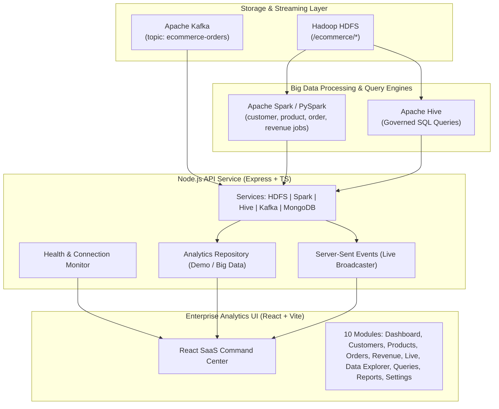

# E-Commerce Big Data Analytics Platform — System Architecture

## Overview
The **E-Commerce Big Data Analytics Platform** is an enterprise-grade analytics command center designed to process, analyze, and visualize high-velocity e-commerce data across four core Big Data technologies:

1. **Apache Hadoop HDFS**: Distributed block storage for customers, products, orders, transactions, and delivery datasets.
2. **Apache Spark / PySpark**: Large-scale distributed data processing engine for batch cleaning, aggregation, and PySpark analytics jobs.
3. **Apache Hive**: Distributed SQL query engine executing governed analytical queries over HDFS external tables.
4. **Apache Kafka**: High-throughput distributed event streaming platform handling real-time order lifecycle events.

---

## Architectural Diagram

---

## System Components

### 1. Frontend Client (`frontend/`)
- Built with **React 18**, **Vite**, **TypeScript**, **Tailwind CSS**, **Recharts**, and **Wouter**.
- Features 10 navigation modules:
  - `/dashboard`: Master executive summary & service status pills
  - `/customers` & `/customers/:id`: Customer demographic & spending analytics
  - `/products` & `/products/:id`: SKU performance, quantity sold & rating breakdown
  - `/orders`: Order status distribution & delivery latency metrics
  - `/revenue`: Financial performance, profit margins & discount absorption
  - `/live`: Real-time Kafka order stream updates via Server-Sent Events (SSE)
  - `/data-explorer`: Dataset storage, processing, and query lineage explorer
  - `/queries`: Predefined governed Hive SQL execution engine
  - `/reports`: Analytical report compiler & CSV/PDF exporter
  - `/settings`: Infrastructure connection health check & mode status

### 2. API Backend (`backend/`)
- Modular **Node.js Express + TypeScript** architecture:
  - Dual Mode Support: `DATA_MODE=demo` (synthetic high-fidelity data) vs `DATA_MODE=bigdata` (live Hadoop/Spark/Hive/Kafka connections)
  - Health checks querying actual WebHDFS endpoints, Spark executors, Hive JDBC, and Kafka brokers
  - Server-Sent Events (SSE) endpoint `/api/live/stream` pushing real-time order events to connected dashboards

### 3. Big Data Integration Suite (`bigdata/`)
- **PySpark Jobs**: `customer_analysis.py`, `product_analysis.py`, `order_analysis.py`, `revenue_analysis.py`
- **Hive DDL & Queries**: `schema.sql` and 7 governed queries (`top_products.sql`, `revenue_by_category.sql`, `monthly_revenue.sql`, `top_customers.sql`, `orders_by_location.sql`, `average_delivery_time.sql`, `cancelled_orders.sql`)
- **Kafka Stream**: Python producer & consumer scripts emitting to topic `ecommerce-orders`